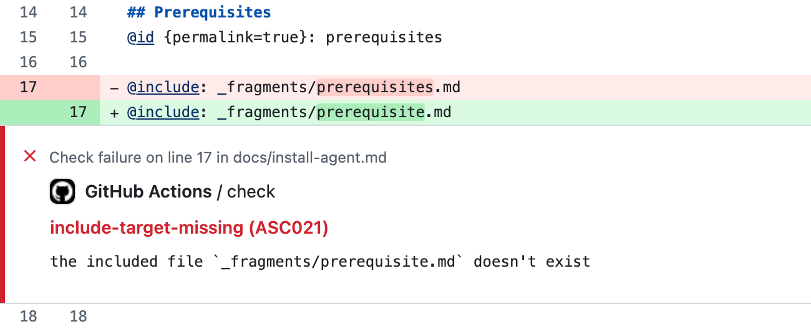

+++
title = "The Docs Tool I Wanted"
description = "I wanted a docs-as-code setup that gave writing docs the same level of support programming languages get in an IDE, so I built Ascribe."
keywords = "docs as code, Ascribe, technical writing, documentation tooling, language server"
date = "2026-11-03"
tags = ["technical writing", "documentation", "tooling"]
+++

<kbr-admonition type="note">
tl;dr: I wanted docs-as-code to get the same level of support that programming languages get in an IDE: checks as you type, hints, a CLI and a UI that agree. Ascribe is my opinionated take on what that looks like. It's 0.4, early, and open source.
</kbr-admonition>

Docs-as-code is an approach to documentation that pairs technical writing process and knowledge with the environments and tools software engineers use. There are other definitions, but I find this one the most useful.

In my experience, docs-as-code has mostly hewed strongly towards software engineer tools, process, and paradigms. But I've missed features that dedicated tech writing tools like Flare or DITA have had for years: content reuse, conditional content, structured page types, and templates.

Tech writers using docs-as-code often rebuild those features for their specific site generator or build tool. In Docusaurus, reusing content means an MDX import. In Sphinx, it's an include directive. In Hugo, it's a shortcode. Each one only works in its own generator, and the editor treats it as text it doesn't understand. Writers find out an include path is wrong when the build fails, or when a reader finds the gap.

Ascribe moves those features out of the site generator and into the Markdown itself. Includes, variants, variables, and page types are part of the file format, and a spec defines what each one means. The compiler that builds the docs also runs in the editor, the CLI, and CI, so it understands them everywhere. Mistype an include path and the editor underlines it as you type, the way a code editor underlines a misspelled import.

That's what I mean by IDE support for docs. Not a nicer text editor, but tooling that understands what you wrote.

It also means those features don't depend on a site generator. I've only created an Astro integration so far. But Ascribe writes its output in a documented format so others can be added.

## Ascribe everywhere

One of the really useful things about Ascribe is that it's available in many forms. The VS Code extension brings everything together with a UI. The CLI gives programmatic access to the same tools and is great for use in CI like GitHub Actions. The MCP server gives AI agents a map to the Ascribe tools.

All of these run the same binary and provide access to the same commands and information about your docs.

## Why build something new?

There are lots of great documentation tools out there already. I've used many of them. But most of them make tradeoffs that I wasn't happy with.

I'll be totally upfront: I used AI tools to help me build Ascribe. There's no way I would have been able to have created the project without them. Not that I'm incapable of building something equivalent: I simply don't have the time to. Working full time, being a dad, trying to contribute to my community and be a useful human being in general... there just isn't enough time.

What this means though is that I can finally take all of the things that I enjoyed about DITA, Sphinx, AsciiDoc, Flare, and Markdown and bring them together into a package that works the way I want it to.

## My opinionated choices

So, what does the docs tool of my dreams look like? Why did I build Ascribe the way I did? Here's a non-exhaustive list:

- No whitespace sensitivity. I greatly dislike witespace sensitive languages. They feel extremely fiddly to me. Thus, Ascribe's Markdown directives (mostly) don't pay attention to whitespace. One downside to this is that block-level directives have to have explicit `@end` declarations. It's a bit noisier than I like, but it's the best way to do things without making whitespace carry meaning.
- Plain markdown. While Ascribe introduces directives for Markdown, the primary goal was to make those directives read as naturally as possible. They shouldn't ever feel like programming or require building and rendering to make sense.
- One compiler. As mentioned earlier, Ascribe has a single binary that every interface (UI, CLI) uses. This was important to me because I wanted every Ascribe surface to agree on the state of the docs.
- Deterministic tools. Ascribe itself provides deterministic tools. It's opinionated about how to do things. But it has no built-in AI tools. It's never making dynamic judgements about your docs - only executing well-defined tasks and reporting on the state of your docs.

## What Ascribe looks like

Here's part of a page from Quill, the example project in the Ascribe repository, trimmed down. Quill is a made-up product, but the page is a common type: install steps that differ by package manager, a section shared with other pages, and the product's name kept in one place.

````markdown
---
type: page
title: Install the Quill agent
available: cloud, self-managed preview 3.3
---

The {product} agent watches your docs repository and syncs changes to {product}.

## Prerequisites

@id {permalink=true}: prerequisites

@include: _fragments/prerequisites.md

## Install the agent

@variant {pm=npm}:

```shell
npm install -g @quill/agent
```

@variant {pm=pnpm}:

```shell
pnpm add -g @quill/agent
```

@end
````

`{product}` is a phrase declared in `ascribe.toml`. `@include` pulls in a shared file. The `@variant` blocks become tabs on the site, and separate sections in the plain Markdown output.

### In the editor

Say I mistype the include path as `_fragments/prerequisite.md`, without the "s". The VS Code extension underlines the path as I type, and hovering over it shows the problem.

**TODO screenshot:** VS Code with the `@include` path underlined

The same check from the command line, trimmed to the two problems that matter here:

```
[ASC021] Error: the included file `_fragments/prerequisite.md` doesn't exist
    ╭─[ docs/install-agent.md:17:11 ]
    │
 17 │ @include: _fragments/prerequisite.md
    │           ─────────────┬────────────
    │                        ╰────────────── include-target-missing
    │
    │ Help: Fix the path. It's relative to the including file, or to the content root when it starts with `/`, and the file must be a Markdown source file inside the content root.
────╯
[ASC155] Advice: no file includes this fragment, so nothing publishes it
   ╭─[ docs/_fragments/prerequisites.md:1:1 ]
   │
 1 │ Before you install the agent, make sure you have:
   │ ────────────────────────┬────────────────────────
   │                         ╰────────────────────────── fragment-unused
   │
   │ Help: Include the fragment where it belongs with `@include`, or delete it when nothing needs it any more.
───╯
```

The second problem follows from the first. Ascribe checks the whole project, not only the file I'm editing, so it notices that the real fragment is no longer used anywhere.

### In CI

The same checks run in CI. The GitHub Actions workflow in the docs runs two commands on every pull request:

```yaml
- run: npx ascribe check --deny-warnings --format github
- run: npx ascribe fmt --check --format github
```

`--format github` turns each problem into an annotation on the pull request's line, the way a code linter's problems show up. If I'd missed the underline in the editor, the pull request would fail and point at the `@include` line. And because `npx` runs the version of Ascribe that `package.json` pins, CI and the editor run the same checks.



### In review

Passing checks don't catch everything. Someone still has to read it, and reviewing docs as a source diff can be awkward.

Ascribe's review compares resolved pages, not files, and shows the pull request as rendered pages with the changes marked. If I edit the prerequisites fragment, the change shows on every page that includes it. Reformatting shows on none. A reviewer sees what readers will see.

**TODO screenshot:** the page preview in review mode, with a changed block marked

Comments left on a rendered page are ordinary GitHub review comments on the source lines. Ascribe itself doesn't store comments. The pull request is the record and anyone can reply on GitHub. Review runs in the VS Code page preview, in the site preview under `astro dev`, and as an HTML report from CI.

### The pieces

Put together, Ascribe is:

- `ascribe`, a command-line tool written in Rust, with `check`, `build`, `fmt`, and a language server.
- A VS Code extension with the page preview, site preview, and review. Other editors get the checks through the language server.
- An MCP server and editing hooks for AI agents working on the docs.
- An Astro integration for publishing the site.
- Optional hookups to Vale for prose style and lychee for external links, which you install separately.

The [docs](https://ascribed-dev.com/go/docs/) cover the rest.

## It's not for everyone

.

## Conclusion

.

---

- What that looks like
  - One worked example: an editor error, the same error in CI, then the PR shown as rendered pages
  - Use real diagnostic output, not polished screenshots. Link the rest of the docs.
  - Short "what it is" paragraph: a Rust CLI with a language server, a VS Code extension, publishing through Astro, alongside Vale and lychee
- What preferences cost
  - Opinionated means it won't fit everyone
  - The full UI is VS Code only (the LSP works elsewhere), publishing requires Astro 7, review is GitHub only
  - No migration path from MDX or other Markdown setups
  - 0.x: a minor version can still break things
  - Leaving keeps your source pages, but the plain output is a flattened snapshot, so you lose single-sourcing
- Close
  - If you also wanted docs work to feel like working in a good IDE, try it and tell me where it breaks
  - Link the repo, not an install command

## Notes

- Expected objection: Markdown is somewhat whitespace-sensitive (indented code blocks, nested lists). Say how far the rule goes, or whether Ascribe changes Markdown's own behavior there.
- Decide: "me" or "Bryo Studio" (README says "Made by Bryo Studio").
- Decide: mention that Ascribe was built with agents? First commit 2026-09-09, ~2,400 commits by 0.4.3. If yes, link AI Agent Workflows.
- Avoid: a "Code has / Docs now have" table, "different category" positioning, type-system/generics analogies, claiming docs as code failed.
- Fact-check results (Ascribe repo, as of 0.4.3):
  - Update: OpenAPI and `ascribe.addresses` (redirects) shipped in 0.4.4. `check --format github` shipped in 0.4.5.
  - The content model is a schema (typed front matter plus declared names), not a type system.
  - `@snippet` reads code from files; it doesn't test it. `ascribe observe` runs your test command and records the result. `drift` doesn't fail CI by default.
  - The MCP server is a local stdio server for agents working on the docs. Reading agents get llms.txt, `.md` pages, or `agents index`.
  - Ascribe writes a site output; Astro (via `@ascribed/astro`) renders the website. llms.txt is written only when `[consumer] site` is set.
  - "Plain CommonMark" applies to the plain output only. The site output uses custom elements.
  - "Hosts nothing, calls no model" holds, but review talks to GitHub as you, and `sources`, `report links`, and `report agents` reach the network.
  - Hooks support Claude Code, Codex, and Copilot, not Cursor or Gemini.
  - Host files (`_headers`, `_redirects`) are Netlify only.
  - No Intel Macs or Alpine/musl. Node 24+ for npm, or the standalone binary.
