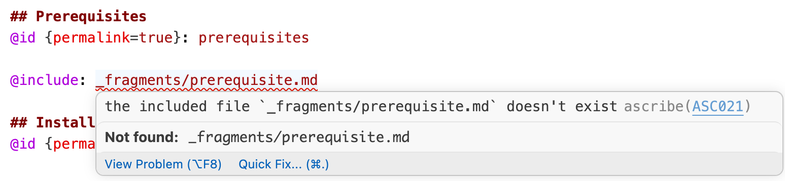

+++
title = "The Docs Tool I Wanted"
description = "I wanted a docs-as-code setup that gave docs the support programming languages get in an IDE, so I built Ascribe."
keywords = "docs as code, Ascribe, technical writing, documentation tooling, language server"
date = "2026-11-03"
tags = ["technical writing", "documentation", "tooling"]
+++

<kbr-admonition type="note">
tl;dr: I wanted docs-as-code to get the support programming languages get in an IDE: checks as you type, hints, a CLI and a UI that agree. Ascribe is my opinionated take on what that looks like. It's 0.4, early, and open source under the MPL.
</kbr-admonition>

Docs-as-code is an approach to documentation that pairs technical writing process and knowledge with the environments and tools software engineers use. There are other definitions, but I find this one most useful.

In my experience, docs-as-code has hewed strongly towards software engineering tools, process, and paradigms. But I've missed features that dedicated tech writing tools like Flare or DITA have had for years: content reuse, conditional content, structured page types, and templates.

Tech writers using docs-as-code often rebuild those features for their site generator or build tool. In Docusaurus, reusing content means an MDX import. In Sphinx, it's an include directive. In Hugo, it's a shortcode. Each one only works in its own generator, and the editor treats it as text it doesn't understand. Writers find out an include path is wrong when the build fails, or when a reader finds the gap.

Ascribe moves those features out of the site generator and into the Markdown itself. Includes, variants, variables, and page types are part of the file format and its content model, and a spec defines what each one means. The compiler that builds the docs also runs in the editor, the CLI, and CI, so it understands them everywhere. Mistype an include path and the editor underlines it as you type, the way a code editor underlines a misspelled import.

That's what I mean by IDE support for docs. Not a nicer text editor, but tooling that understands what you wrote.

It also means those features don't depend on a site generator. I've only built an Astro integration so far, but Ascribe writes its output in a documented format so others can be added.

## Ascribe everywhere

Ascribe comes in a few forms. The VS Code extension brings everything together with a UI. The CLI exposes the same tools for scripts and CI like GitHub Actions. The MCP server gives AI agents a map to the Ascribe tools.

All of them run the same binary and report the same information about your docs.

## Why build something new?

There are plenty of good documentation tools already, and I've used many of them. But most make tradeoffs I wasn't happy with.

I'll be upfront: I used AI tools to build Ascribe. I couldn't have created the project without them. Not because I'm incapable of building something equivalent. Working full time, being a dad, trying to contribute to my community and be a useful human being in general... there just isn't enough time.

What this means is I can finally take the things I enjoyed about DITA, Sphinx, AsciiDoc, Flare, and Markdown and bring them together in a package that works the way I want.

## My opinionated choices

So, what does the docs tool of my dreams look like? Here's a non-exhaustive list:

- No whitespace sensitivity. I greatly dislike whitespace-sensitive languages. They feel fiddly to me. So Ascribe's Markdown directives (mostly) ignore whitespace. Markdown's own rules still apply: a directive indented four spaces is a code block, and one inside a list item sits at the item's indent. But the spacing inside a directive line, and the indentation between a block directive and its `@end`, mean nothing. The downside is that block-level directives need an explicit `@end`. It's noisier than I'd like, but it's the best way to avoid making whitespace carry meaning.
- Plain Markdown. Ascribe adds directives to Markdown, but the goal was to make them read as naturally as possible. They shouldn't feel like programming or need a build to make sense.
- One compiler. Every interface (UI, CLI) uses the same binary, because I wanted every Ascribe surface to agree on the state of the docs.
- Deterministic tools. Ascribe is opinionated about how to do things, but it has no built-in AI. It never makes judgement calls about your docs. It only runs well-defined tasks and reports what it finds.
- Careful with your files. Every command that writes, like `fmt` or `check --fix`, refuses to touch a file git couldn't restore unless you pass `--force`. Each one takes `--dry-run` too.

## What Ascribe looks like

Here's a trimmed page from Quill, the example project in the Ascribe repository. Quill is a made-up product, but the page is a common type: install steps that differ by package manager, a section shared with other pages, and the product's name kept in one place.

````markdown
---
type: page
title: Install the Quill agent
available: cloud, self-managed preview 3.3
---

The {product} agent watches your docs repository and syncs changes to {product}.

## Prerequisites

@id {permalink=true}: prerequisites

@include: _fragments/prerequisites.md

## Install the agent

@variant {pm=npm}:

```shell
npm install -g @quill/agent
```

@variant {pm=pnpm}:

```shell
pnpm add -g @quill/agent
```

@end
````

`{product}` is a phrase declared in `ascribe.toml`. `@include` pulls in a shared file. The `@variant` blocks become tabs on the site, and separate sections in the plain Markdown output. The `available` line says which release lines the page applies to, and Ascribe builds one site per line from the same source. `@id {permalink=true}` gives the section a stable `go/prerequisites` address that the product can link to, and that Ascribe checks never breaks.

### In the editor

Say I mistype the include path as `_fragments/prerequisite.md`, without the "s". The VS Code extension underlines the path as I type, and hovering over it shows the problem.



The same check from the command line, trimmed to the two problems that matter here:

```
[ASC021] Error: the included file `_fragments/prerequisite.md` doesn't exist
    ╭─[ docs/install-agent.md:17:11 ]
    │
 17 │ @include: _fragments/prerequisite.md
    │           ─────────────┬────────────
    │                        ╰────────────── include-target-missing
    │
    │ Help: Include `_fragments/prerequisites.md`
────╯
[ASC155] Advice: no file includes this fragment, so nothing publishes it
   ╭─[ docs/_fragments/prerequisites.md:1:1 ]
   │
 1 │ Before you install the agent, make sure you have:
   │ ────────────────────────┬────────────────────────
   │                         ╰────────────────────────── fragment-unused
   │
   │ Help: Include the fragment where it belongs with `@include`, or delete it when nothing needs it any more.
───╯
```

The first problem's help names the file I meant. The second follows from the first: Ascribe checks the whole project, not only the file I'm editing, so it notices the real fragment is no longer used.

### In CI

The same checks run in CI. The GitHub Actions workflow in the docs runs two commands on every pull request:

```yaml
- run: npx ascribe check --deny-warnings --format github
- run: npx ascribe fmt --check --format github
```

`--format github` turns each problem into an annotation on the pull request's line, the way a code linter's problems show up. If I'd missed the underline in the editor, the pull request would fail and point at the `@include` line. And because `npx` runs the version of Ascribe that `package.json` pins, CI and the editor run the same checks.


### In review

Checks don't catch everything. Someone still has to read the docs, and reviewing them as a source diff can be awkward.

Ascribe's review compares resolved pages, not files, and shows the pull request as rendered pages with the changes marked. If I edit the prerequisites fragment, the change shows on every page that includes it. Reformatting shows on none. A reviewer sees what readers will see.

Here's the HTML preview, from `ascribe diff --format html`, for a one-phrase change to the prerequisites fragment. The install page's file didn't change, but the preview shows the change where it lands:


Comments left on a rendered page are ordinary GitHub review comments on the source lines, posted through your GitHub sign-in or the `gh` CLI. Ascribe doesn't store them. The pull request is the record, and anyone can reply on GitHub. Review runs in the VS Code page preview and in the site preview under `astro dev`. CI produces the HTML preview, which shows the changes but not the comments.

### The pieces

Put together, Ascribe is:

- `ascribe`, a command-line tool written in Rust, with `check`, `build`, `fmt`, `diff`, and a language server.
- A VS Code extension with the page preview, site preview, and review. Other editors get the checks through the language server.
- An MCP server, editing hooks, and an `agents sync` command that writes `AGENTS.md` and a skill, for AI agents working on the docs. The hooks support Claude Code, Codex, and Copilot.
- An Astro integration for publishing the site.
- Optional hookups to Vale for prose style and lychee for external links, which you install separately.

That's the part this post shows. There's more I haven't covered: versioned builds from one source, code examples pulled from real files with `@snippet` and checked against recorded test runs, links to OpenAPI operations checked against the spec, redirects recorded when a page moves, and page templates. The [docs](https://ascribed-dev.com/go/docs/) cover the rest.

## It's not for everyone

Ascribe is opinionated, it's changing quickly, and there's one person (me) building it on fractional time. Some of its limits are deliberate, and some are just where the project is today. Both are worth knowing before you try it.

### By design

- **It's Markdown, not MDX.** If your docs rely on React components in the page, Ascribe won't run them. Directives in the source and web components in the output cover things like tabs, notes, and steps, but not arbitrary components. I don't plan to change this, because MDX makes every author work in JSX.
- **Block directives need `@end`.** That's the cost of not making whitespace meaningful. If you like indentation-based syntax, like reStructuredText, Ascribe may feel noisier.
- **It's for people who work in an editor and git.** There's no WYSIWYG editor or CMS. Writers and reviewers work in Markdown files and pull requests. If your contributors don't, Ascribe isn't a good fit.

### For now

- **It's 0.x.** Any release can still change behavior, and the changelog marks each change that does. The spec calls itself a draft until 1.0. Pin the version, as the CI recipe does, and read the changelog before you upgrade.
- **I maintain it on my own.** Time is limited, but I'll do my best to keep building and supporting it.
- **Publishing a site needs Astro.** `@ascribed/astro` is the only site integration. `ascribe preview` serves your pages without Astro while you write, and the output format is documented so other site generators can be added, but nobody has built one yet.
- **The full editor experience is VS Code only.** The page preview, site preview, sidebar, and review are in the VS Code extension. Other editors, like Neovim, get the checks through the language server.
- **Review comments are GitHub only.** Review's comparison works in any git repository, but its comments are GitHub pull request comments, GitHub Enterprise included. A team on GitLab or Bitbucket gets the marked-up pages without the comments.
- **There's no migration tool.** `ascribe init` adopts a folder of Markdown as it is, `check --fix` converts GitHub alerts to `@note`, and `ascribe baseline` parks existing advice so CI reports only new problems. But moving from Docusaurus, MkDocs, or Sphinx means converting includes, tabs, admonitions, and front matter by hand, or with your own script or AI tools.
- **No translations and no built-in search.** Ascribe has no i18n support, and the site integration doesn't ship a search. If you need either, you add it yourself.
- **It runs on macOS on Apple silicon, Linux with glibc, and Windows.** Intel Macs and Alpine Linux aren't supported. The npm package needs Node 24 or newer, and the site needs Astro 7.3.5 or newer. The standalone binary needs neither.

### Leaving

Ascribe hosts nothing, and nothing it needs lives outside your repository, so leaving is a matter of files. Your source pages are still Markdown, but other tools show directives like `@variant` and phrases like `{product}` as literal text. `ascribe build` also writes a plain CommonMark version of every page, with includes resolved, phrases filled in, and variants turned into sections. It's a clean export, but it's a snapshot: the reuse is flattened into each page, so you'd lose single-sourcing on the way out.

## Conclusion

When I write code, my editor tells me I'm wrong before anyone else has to. I wanted the same for docs. Ascribe is my attempt at it: the features tech writers rely on, built into the Markdown itself, and checked the same way in the editor, the CLI, CI, and review.

None of that makes docs good on its own. As I wrote in [AI Agent Workflows](../ai-agent-workflows.md), deterministic tools are scaffolding, not judgment. A page can pass every check and still answer the wrong question. The checks take the mechanical mistakes off the table, like a broken include, an undeclared phrase, or a link to a page that moved, so reviewers can spend their attention on whether the docs say the right thing.

If you've also wanted docs work to feel like working in a good IDE, try Ascribe on a small project and tell me where it breaks. The [repository](https://github.com/ascribed-dev/ascribe) has the docs, the examples, and the [issue tracker](https://github.com/ascribed-dev/ascribe/issues).
